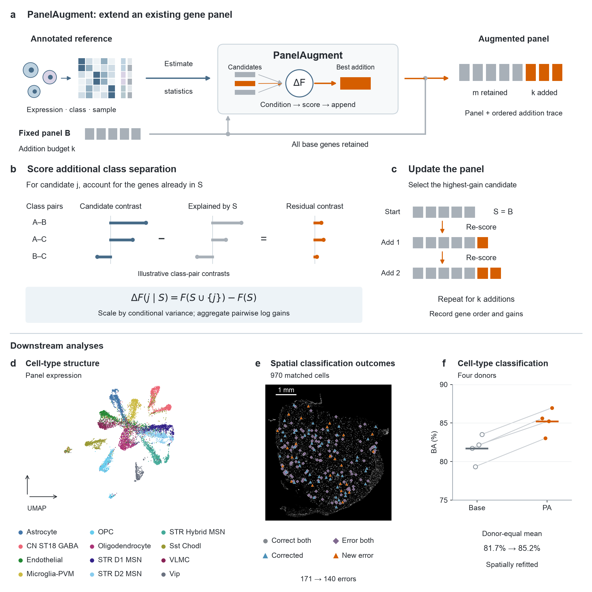
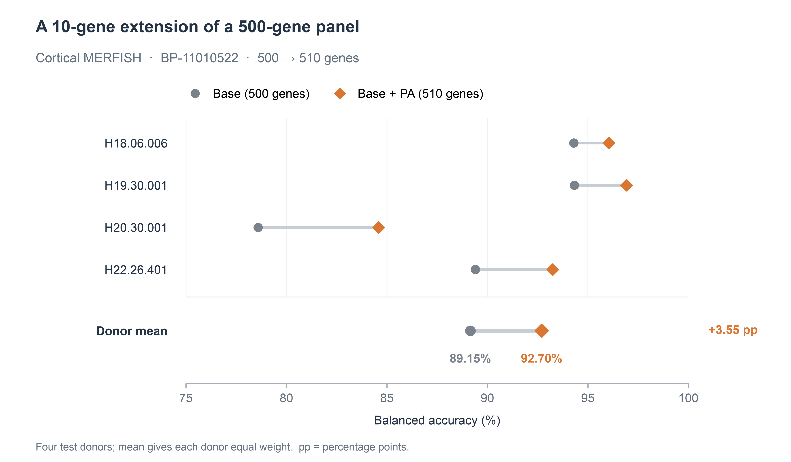

# PanelAugment (PA)

**Extend an existing gene panel while keeping every starting gene.**

PanelAugment selects additional genes from annotated reference expression, given a fixed, ordered base panel and an addition budget. It accounts for the genes already selected and adds candidates by their conditional gain in class separation, using donor-aware training statistics.

[中文](README.zh-CN.md) · [Quick start](#quick-start) · [MERFISH example](#a-real-example-500--510-genes) · [Base panels and data](#base-panels-and-original-data) · [Documentation](#documentation)

## Overview



**Figure 1.** PA retains the ordered base panel, scores each candidate conditional on the current selection, and repeats for the requested addition budget. Panels a–c describe the method; panels d–f illustrate downstream analyses using human caudate data (BP-11010510, 140 + 20 genes), with spatially refitted classification in e,f. [Full-size PNG](docs/assets/pa-overview.png) · [SVG](docs/assets/pa-overview.svg) · [PDF](docs/assets/pa-overview.pdf).

The toolkit includes a Python API, command-line tools, PA preprocessing with integrated measurement-consistency gating, and **24 numbered base panels across three datasets**.

## Quick start

Use Python 3.10 or newer. Clone the repository and install from its root:

```bash
git clone https://github.com/zhailongjie/panelaugment.git
cd panelaugment
python -m venv .venv
source .venv/bin/activate
python -m pip install .
panelaugment demo --out demo-output
```

On Windows, activate the environment with `.venv\Scripts\activate`. The core requires NumPy; install `'.[h5ad]'` for H5AD input or `'.[sparse]'` for sparse matrices.

The offline demo retains `Gene00, Gene03` and adds `Gene08, Gene04, Gene01, Gene06`, in that order. It uses synthetic data to demonstrate the interface. Every selection writes:

| File | Contents |
| --- | --- |
| `genes.csv` | Gene order and base/addition roles |
| `panels.json` | Complete selected panel and settings |
| `trace.json` | Objective and gain at each selection step |
| `pair_support.json` | Shared training groups for each class pair |
| `run.json` | Input identifiers, parameters and environment |

Choose a new output directory for each run. For an offline example including candidate QC and measurement gating, run `python examples/preprocessing_demo.py`.

## A real example: 500 → 510 genes

In the cortical MERFISH benchmark, **BP-11010522 + 10 genes** keeps all 500 starting genes and produces a 510-gene panel. Donor-averaged balanced accuracy increases from **89.15% to 92.70%** (+3.55 percentage points), with improvements in all four evaluated donors.



This is a selected example from the manuscript, evaluated with a reference-trained classifier. Scores average the four test donors equally. See the [complete example](examples/merfish/README.md) for input preparation, selection commands, ordered output, evaluation settings and source values.

The ten additions, in selection order, are:

```text
FYB, SRGAP2, TLR7, OLIG2, HLA-E, SLC12A2, GPR37, PTPRC, APBB1IP, A2M
```

[500-gene base](src/panelaugment/resources/base_panels/genes/BP-11010522.tsv) · [510-gene output](examples/merfish/genes.csv) · [Donor scores](examples/merfish/donor_scores.csv) · [Recreate the plot](examples/merfish/plot_results.py)

## Use your own data

Supply expression with cells in rows and genes in columns, class labels, training-group IDs, and an ordered base. With an already normalized `training.npz` containing `X`, `y`, `groups` and `genes`:

```python
import numpy as np
from panelaugment import PanelAugmenter, load_base_panel

with np.load("training.npz", allow_pickle=False) as data:
    model = PanelAugmenter(ridge=1.0).fit(
        data["X"], data["y"], data["groups"], gene_names=data["genes"],
    )
base = load_base_panel("BP-11010522")
result = model.select(base_genes=base.genes, n_added=10)
print(result.added_genes)
```

The input must contain every base gene with matching identifiers. The equivalent command is:

```bash
panelaugment select --input training.npz --normalized \
  --base-id BP-11010522 --n-added 10 --out selection-output
```

Use `--base base.txt` for your own ordered base. For raw counts, use [PA preprocessing](docs/preprocessing.md): full-library CP10K/log1p, training-fitted candidate QC, and measurement-consistency gating from the supplied donor aggregates. Keep the original full-library totals when using a candidate-only matrix. [Detailed Python and CLI usage](docs/usage.md) covers NPZ/H5AD input and all normalization modes.

## Base panels and original data

The package contains **24 ordered base panels**, with 140, 300 or 500 genes. Click a BP ID to inspect its exact gene list. The manuscript uses addition budgets of 10, 20, 30, 40, 50 and 100 genes.

| Dataset | Base genes | Panel IDs and gene lists | Original data |
| --- | ---: | --- | --- |
| DLPFC | 140 | [BP-11010501](src/panelaugment/resources/base_panels/genes/BP-11010501.tsv) · [BP-11010502](src/panelaugment/resources/base_panels/genes/BP-11010502.tsv) · [BP-11010503](src/panelaugment/resources/base_panels/genes/BP-11010503.tsv) | [Source data](docs/data.md#dlpfc) |
| DLPFC | 300 | [BP-11010504](src/panelaugment/resources/base_panels/genes/BP-11010504.tsv) · [BP-11010505](src/panelaugment/resources/base_panels/genes/BP-11010505.tsv) · [BP-11010506](src/panelaugment/resources/base_panels/genes/BP-11010506.tsv) | [Source data](docs/data.md#dlpfc) |
| DLPFC | 500 | [BP-11010507](src/panelaugment/resources/base_panels/genes/BP-11010507.tsv) · [BP-11010508](src/panelaugment/resources/base_panels/genes/BP-11010508.tsv) · [BP-11010509](src/panelaugment/resources/base_panels/genes/BP-11010509.tsv) | [Source data](docs/data.md#dlpfc) |
| Human caudate | 140 | [BP-11010510](src/panelaugment/resources/base_panels/genes/BP-11010510.tsv) · [BP-11010511](src/panelaugment/resources/base_panels/genes/BP-11010511.tsv) · [BP-11010512](src/panelaugment/resources/base_panels/genes/BP-11010512.tsv) | [Source data](docs/data.md#human-caudate) |
| Human caudate | 300 | [BP-11010513](src/panelaugment/resources/base_panels/genes/BP-11010513.tsv) · [BP-11010514](src/panelaugment/resources/base_panels/genes/BP-11010514.tsv) · [BP-11010515](src/panelaugment/resources/base_panels/genes/BP-11010515.tsv) | [Source data](docs/data.md#human-caudate) |
| Cortical MERFISH | 140 | [BP-11010516](src/panelaugment/resources/base_panels/genes/BP-11010516.tsv) · [BP-11010517](src/panelaugment/resources/base_panels/genes/BP-11010517.tsv) · [BP-11010518](src/panelaugment/resources/base_panels/genes/BP-11010518.tsv) | [Source data](docs/data.md#cortical-merfish) |
| Cortical MERFISH | 300 | [BP-11010519](src/panelaugment/resources/base_panels/genes/BP-11010519.tsv) · [BP-11010520](src/panelaugment/resources/base_panels/genes/BP-11010520.tsv) · [BP-11010521](src/panelaugment/resources/base_panels/genes/BP-11010521.tsv) | [Source data](docs/data.md#cortical-merfish) |
| Cortical MERFISH | 500 | [BP-11010522](src/panelaugment/resources/base_panels/genes/BP-11010522.tsv) · [BP-11010523](src/panelaugment/resources/base_panels/genes/BP-11010523.tsv) · [BP-11010524](src/panelaugment/resources/base_panels/genes/BP-11010524.tsv) | [Source data](docs/data.md#cortical-merfish) |

DLPFC panels use Ensembl IDs; caudate and MERFISH panels use gene symbols. Expression data are available from the linked source studies; the package bundles the ordered base lists.

```bash
panelaugment panels list
panelaugment panels export --id BP-11010522 --out BP-11010522.txt
```

[Panel catalog](docs/base-panels.md) · [Original data and accessions](docs/data.md)

## Documentation

| Guide | What it covers |
| --- | --- |
| [Method](docs/method.md) | Balanced moments, conditional gain and greedy selection |
| [Preprocessing](docs/preprocessing.md) | Counts, candidate QC and integrated measurement gating |
| [Python and CLI usage](docs/usage.md) | Complete input examples and API options |
| [MERFISH worked example](examples/merfish/README.md) | One fixed panel, budget, ordered output and results |
| [Base panels](docs/base-panels.md) | Panel identifiers, gene lists and metadata |
| [Reproducible runs](docs/reproducibility.md) | Data roles, normalization and output records |

PA optimizes a training discrimination objective. Downstream performance depends on the data, base panel and evaluation setting. It estimates a dense gene covariance matrix; candidate QC helps keep memory requirements manageable.

For development, install `python -m pip install '.[dev,h5ad]'`, then run `python -m pytest` and `python -m build`.

Software license: not yet specified.
