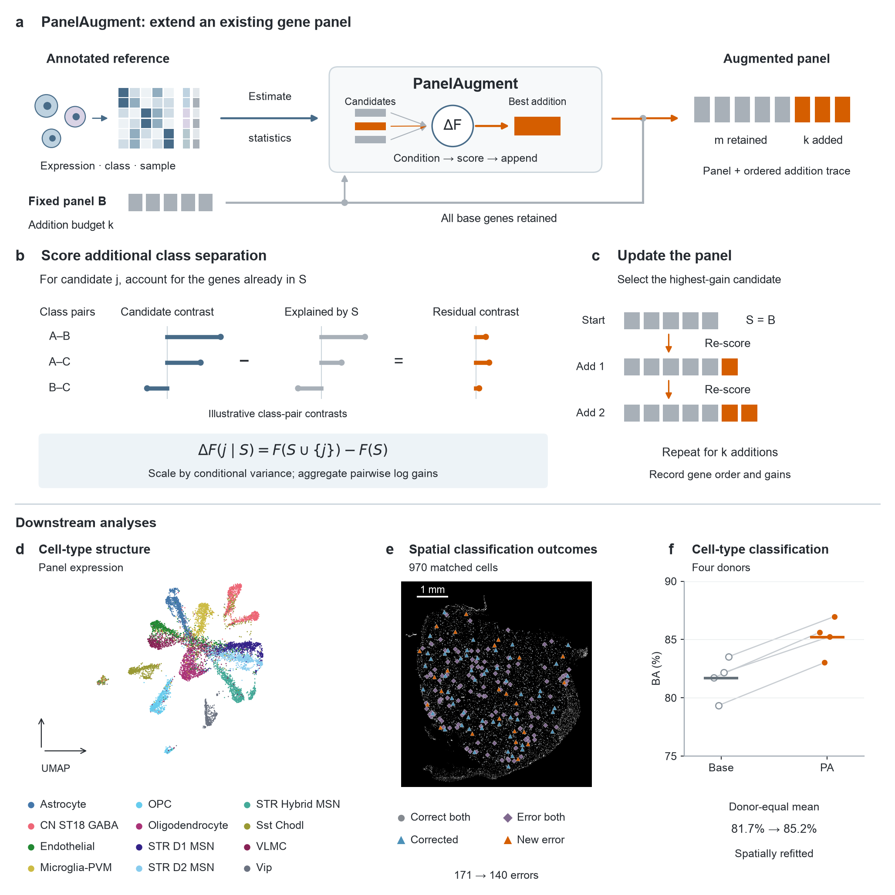
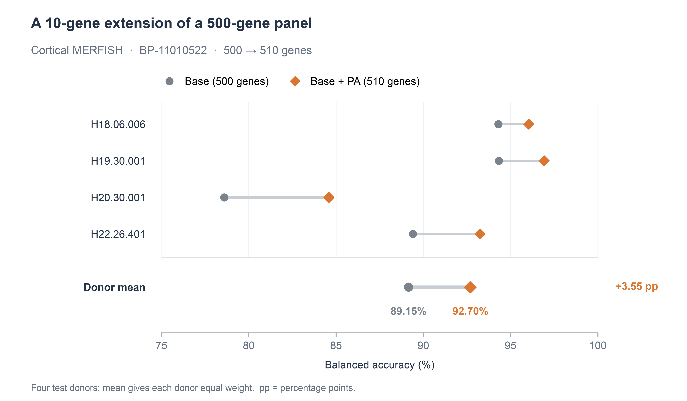

# PanelAugment（PA）

**保留现有面板的全部基因，按指定预算选择新增基因。**

PanelAugment 以带注释的参考表达数据、有序基础面板和扩增预算为输入。它基于考虑供体差异的训练统计量，在每一步计算候选基因相对于已选基因的条件判别增益，依次扩增面板。

[English](README.md) · [快速开始](#快速开始) · [MERFISH 实例](#真实实例从-500-到-510-个基因) · [基础面板与原始数据](#基础面板与原始数据) · [文档导航](#文档导航)

## 方法总览



**图 1。** PA 保留有序基础面板，计算各候选基因相对于当前面板的条件增益，并重复选择直到达到新增预算。a–c 展示方法；d–f 展示人尾状核实例（BP-11010510，140＋20 个基因），其中 e、f 的分类模型在空间数据上重新拟合。[高清 PNG](docs/assets/pa-overview.png) · [SVG](docs/assets/pa-overview.svg) · [PDF](docs/assets/pa-overview.pdf)。

工具包包含 Python API、命令行工具、集成测量一致性门控的 PA 数据预处理，以及**三个数据集的 24 个编号基础面板**。

## 快速开始

需要 Python 3.10 或更新版本。克隆仓库后，在仓库根目录安装：

```bash
git clone https://github.com/zhailongjie/panelaugment.git
cd panelaugment
python -m venv .venv
source .venv/bin/activate
python -m pip install .
panelaugment demo --out demo-output
```

Windows 使用 `.venv\Scripts\activate` 激活环境。核心依赖为 NumPy；使用 H5AD 输入时安装 `'.[h5ad]'`，使用稀疏矩阵时安装 `'.[sparse]'`。

离线演示保留 `Gene00, Gene03`，依次增加 `Gene08, Gene04, Gene01, Gene06`。该演示使用合成数据说明软件接口。每次选择生成以下文件：

| 文件 | 内容 |
| --- | --- |
| `genes.csv` | 基因顺序及基础／新增角色 |
| `panels.json` | 完整面板和选择设置 |
| `trace.json` | 每一步的目标函数值与增益 |
| `pair_support.json` | 各类别对共享的训练组 |
| `run.json` | 输入标识、参数和运行环境 |

每次运行应指定新的输出目录。包含候选基因质控和测量门控的离线示例可通过 `python examples/preprocessing_demo.py` 运行。

## 真实实例：从 500 到 510 个基因

在皮层 MERFISH 基准中，**BP-11010522 + 10 个基因**完整保留 500 个基础基因，得到 510 基因面板。四个测试供体的平衡准确率均提高，供体等权平均由 **89.15% 提高到 92.70%**，增加 3.55 个百分点。



这是从论文中选取的展示实例，采用参考数据训练的分类器，各测试供体等权汇总。[完整示例](examples/merfish/README.md)提供输入准备、选择命令、有序输出、评价设置和绘图数据。

按选择顺序，10 个新增基因为：

```text
FYB, SRGAP2, TLR7, OLIG2, HLA-E, SLC12A2, GPR37, PTPRC, APBB1IP, A2M
```

[500 基因基础面板](src/panelaugment/resources/base_panels/genes/BP-11010522.tsv) · [510 基因输出](examples/merfish/genes.csv) · [供体分数](examples/merfish/donor_scores.csv) · [绘图代码](examples/merfish/plot_results.py)

## 使用自己的数据

输入包括细胞 × 基因表达矩阵、类别标签、训练组标识和有序基础面板。对于已经归一化、包含 `X`、`y`、`groups`、`genes` 的 `training.npz`：

```python
import numpy as np
from panelaugment import PanelAugmenter, load_base_panel

with np.load("training.npz", allow_pickle=False) as data:
    model = PanelAugmenter(ridge=1.0).fit(
        data["X"], data["y"], data["groups"], gene_names=data["genes"],
    )
base = load_base_panel("BP-11010522")
result = model.select(base_genes=base.genes, n_added=10)
print(result.added_genes)
```

输入须包含全部基础基因，且基因标识一致。对应命令行为：

```bash
panelaugment select --input training.npz --normalized \
  --base-id BP-11010522 --n-added 10 --out selection-output
```

使用自定义基础面板时，改为 `--base base.txt`。原始计数通过 [PA 数据预处理](docs/preprocessing.md)完成完整文库 CP10K/log1p、训练侧候选质控，以及基于所提供供体检测量的测量一致性门控。候选子矩阵应保留原始完整文库总量作为归一化分母。[Python 与命令行使用指南](docs/usage.md)包含 NPZ/H5AD 输入和各归一化模式。

## 基础面板与原始数据

工具包提供 **24 个有序基础面板**，规模为 140、300 或 500 个基因。点击 BP 编号可查看完整基因列表。论文采用的新增预算为 10、20、30、40、50 和 100 个基因。

| 数据集 | 基础面板规模 | 面板编号与基因列表 | 原始数据 |
| --- | ---: | --- | --- |
| DLPFC | 140 | [BP-11010501](src/panelaugment/resources/base_panels/genes/BP-11010501.tsv) · [BP-11010502](src/panelaugment/resources/base_panels/genes/BP-11010502.tsv) · [BP-11010503](src/panelaugment/resources/base_panels/genes/BP-11010503.tsv) | [数据入口](docs/data.md#dlpfc) |
| DLPFC | 300 | [BP-11010504](src/panelaugment/resources/base_panels/genes/BP-11010504.tsv) · [BP-11010505](src/panelaugment/resources/base_panels/genes/BP-11010505.tsv) · [BP-11010506](src/panelaugment/resources/base_panels/genes/BP-11010506.tsv) | [数据入口](docs/data.md#dlpfc) |
| DLPFC | 500 | [BP-11010507](src/panelaugment/resources/base_panels/genes/BP-11010507.tsv) · [BP-11010508](src/panelaugment/resources/base_panels/genes/BP-11010508.tsv) · [BP-11010509](src/panelaugment/resources/base_panels/genes/BP-11010509.tsv) | [数据入口](docs/data.md#dlpfc) |
| 人尾状核 | 140 | [BP-11010510](src/panelaugment/resources/base_panels/genes/BP-11010510.tsv) · [BP-11010511](src/panelaugment/resources/base_panels/genes/BP-11010511.tsv) · [BP-11010512](src/panelaugment/resources/base_panels/genes/BP-11010512.tsv) | [数据入口](docs/data.md#human-caudate) |
| 人尾状核 | 300 | [BP-11010513](src/panelaugment/resources/base_panels/genes/BP-11010513.tsv) · [BP-11010514](src/panelaugment/resources/base_panels/genes/BP-11010514.tsv) · [BP-11010515](src/panelaugment/resources/base_panels/genes/BP-11010515.tsv) | [数据入口](docs/data.md#human-caudate) |
| 皮层 MERFISH | 140 | [BP-11010516](src/panelaugment/resources/base_panels/genes/BP-11010516.tsv) · [BP-11010517](src/panelaugment/resources/base_panels/genes/BP-11010517.tsv) · [BP-11010518](src/panelaugment/resources/base_panels/genes/BP-11010518.tsv) | [数据入口](docs/data.md#cortical-merfish) |
| 皮层 MERFISH | 300 | [BP-11010519](src/panelaugment/resources/base_panels/genes/BP-11010519.tsv) · [BP-11010520](src/panelaugment/resources/base_panels/genes/BP-11010520.tsv) · [BP-11010521](src/panelaugment/resources/base_panels/genes/BP-11010521.tsv) | [数据入口](docs/data.md#cortical-merfish) |
| 皮层 MERFISH | 500 | [BP-11010522](src/panelaugment/resources/base_panels/genes/BP-11010522.tsv) · [BP-11010523](src/panelaugment/resources/base_panels/genes/BP-11010523.tsv) · [BP-11010524](src/panelaugment/resources/base_panels/genes/BP-11010524.tsv) | [数据入口](docs/data.md#cortical-merfish) |

DLPFC 面板使用 Ensembl ID，尾状核和 MERFISH 面板使用基因符号。表达数据通过原研究入口获取；工具包内置有序基础基因列表。

```bash
panelaugment panels list
panelaugment panels export --id BP-11010522 --out BP-11010522.txt
```

[面板目录](docs/base-panels.md) · [原始数据与登录号](docs/data.md)

## 文档导航

| 文档 | 内容 |
| --- | --- |
| [方法](docs/method.md) | 平衡统计量、条件增益与贪心选择 |
| [数据预处理](docs/preprocessing.md) | 计数、候选质控与集成测量门控 |
| [Python 与命令行使用](docs/usage.md) | 完整输入示例与 API 参数 |
| [MERFISH 完整示例](examples/merfish/README.md) | 一个面板与预算的输入、输出及结果 |
| [基础面板](docs/base-panels.md) | 编号、基因列表与元数据 |
| [可复现运行](docs/reproducibility.md) | 数据角色、归一化与输出记录 |

PA 优化训练数据中的判别目标，下游表现取决于数据、基础面板及评价设置。实现需要稠密基因协方差矩阵，候选质控有助于控制内存需求。

开发环境可通过 `python -m pip install '.[dev,h5ad]'` 安装，再运行 `python -m pytest` 与 `python -m build`。

软件许可证尚未指定。
