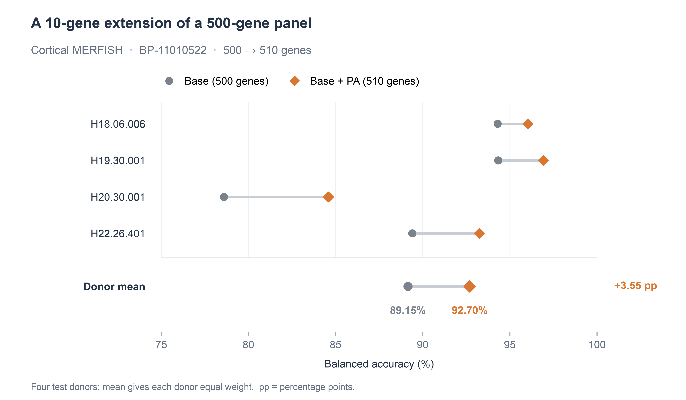

# Cortical MERFISH: a 500-gene panel with 10 additions

This worked example runs PA preprocessing and selection on real reference data.
It starts from **BP-11010522**, preserves all 500 base genes, and selects 10
additional genes. The compact input files are included, so selection runs offline
after installing PanelAugment from the repository root.

## Inputs

| Input | Shape / role |
| --- | --- |
| [`data/training-counts.npz`](data/training-counts.npz) | 2,027 reference cells × 3,225 candidate genes; six training donors and six class labels |
| [`data/library-totals.npy`](data/library-totals.npy) | Full exonic library total for each reference cell, computed over 50,281 genes |
| [`data/measurement-counts.npz`](data/measurement-counts.npz) | Detection counts for 3,225 genes across four MERFISH donors; no class labels |
| [BP-11010522](../../src/panelaugment/resources/base_panels/genes/BP-11010522.tsv) | The ordered 500-gene base |

The training file contains integer **read counts**, `y`, `groups` and `genes`.
It stores the study's candidate axis after training QC and before measurement
gating. The original mapped axis had 3,491 genes; detection in at least 20
training cells and population variance above `1e-10` retained 3,225. The compact
files retain the original full-library totals. These totals are used for
CP10K/log1p normalization, including when candidate columns are removed.

The six training labels are `EXC`, `INC`, `lASC`, `lMGC`, `lOGC` and `lOPC`.
The development donor is excluded from these training rows. Donor identities,
dimensions and file checksums are in [`data/input.json`](data/input.json).
See [original sources and data terms](data/README.md).

## Run preprocessing and selection

From the repository root, after `python -m pip install .`:

```bash
panelaugment preprocess \
  --input examples/merfish/data/training-counts.npz \
  --library-totals examples/merfish/data/library-totals.npy \
  --all-training --mandatory-base-id BP-11010522 \
  --measurement-counts examples/merfish/data/measurement-counts.npz \
  --out merfish-preprocessed

panelaugment select \
  --input merfish-preprocessed/training.npz --normalized \
  --base-id BP-11010522 --n-added 10 --ridge 1 \
  --out merfish-selection

python examples/merfish/check_output.py merfish-selection/panels.json
```

Expected terminal output from the final command:

```text
500 base + 10 added genes: exact match, including order.
```

Use new output directories when repeating the commands. Preprocessing keeps
3,224 candidates: the integrated measurement gate excludes `MALAT1` based on
the four supplied donor detection profiles. The gate uses the same general rule
for every gene: at least two donors below 5% detection and at least two other
donors above 90%, with strict boundaries. No gene name is supplied as an
exclusion. The detection aggregates come from the target MERFISH observations;
training QC and PA statistics use the six reference training donors.

## Read the selected panel

The first 500 output genes exactly preserve the ordered base. Ranks 501–510 are:

| Added rank | Gene |
| ---: | --- |
| 1 | FYB |
| 2 | SRGAP2 |
| 3 | TLR7 |
| 4 | OLIG2 |
| 5 | HLA-E |
| 6 | SLC12A2 |
| 7 | GPR37 |
| 8 | PTPRC |
| 9 | APBB1IP |
| 10 | A2M |

[`genes.csv`](genes.csv) contains the complete 510-gene output with ranks and
base/addition roles. [`expected_panel.json`](expected_panel.json) provides the
same ordered lists in JSON. The generated `merfish-selection/` directory also
contains the objective trace, class-pair support and run settings.

## Read the benchmark results



For this selected panel and budget, donor-averaged balanced accuracy increases
from **89.15% to 92.70%**. The added budget is 2% of the base size, and all four
evaluated donors improve. The plot shows the paired donor scores and their
equal-weight mean; it does not pool the 39,280 test cells into one score.

The scores are from the manuscript's reference-trained classification benchmark.
For each exact panel, reference and target expression are separately normalized
to that panel's total (CP10K/log1p), followed by a training-fitted unweighted
standard scaler and logistic regression (`lbfgs`, `C=1`, `max_iter=3000`,
`random_state=2026`). Training weights are `N / (K × G_c × n_gc)`, balancing
classes and observed groups within each class. This classifier normalization
differs from PA's full-library selection normalization above.

[`donor_scores.csv`](donor_scores.csv) supplies the exact paired scores.
[`aggregate_metrics.csv`](aggregate_metrics.csv) contains the complete set of
comparison methods for this configuration. These are the saved downstream
benchmark results; the commands above execute preprocessing and gene selection.

To recreate the plot from the accompanying scores:

```bash
python -m pip install matplotlib
python examples/merfish/plot_results.py --out-dir merfish-plot
```

## Source studies

- Reference expression: Allen Institute for Brain Science, Human MTG SMART-seq
  (2018 release); Hodge et al., *Nature* (2019),
  [doi:10.1038/s41586-019-1506-7](https://doi.org/10.1038/s41586-019-1506-7).
- Spatial measurements: Fang et al., *Science* (2022),
  [doi:10.1126/science.abm1741](https://doi.org/10.1126/science.abm1741);
  [Dryad dataset](https://doi.org/10.5061/dryad.x3ffbg7mw).

Full data entrances for all three PA benchmarks are in the
[data guide](../../docs/data.md).
